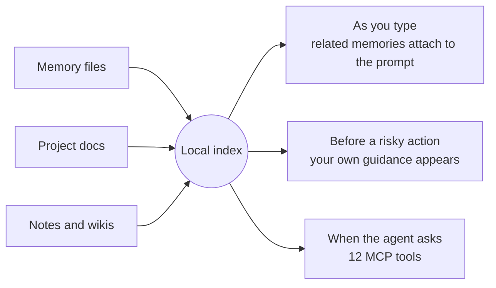

<div align="center">

# local-brain

### What does the AI era need? A brain.

[](https://github.com/honeyground-org/local-brain/actions/workflows/ci.yml)

An open-source memory system for coding agents that lives on your machine.<br>
The right knowledge at the right moment, so work gets more efficient and your agent performs at its best.

[](LICENSE)


</div>

```bash
git clone https://github.com/honeyground-org/local-brain ~/tools/local-brain
cd ~/tools/local-brain && ./install.sh --with-hook --with-guard   # minimal: Python only, nothing else
cd ~/tools/local-brain && ./install.sh --recommended              # reference stack: Qdrant + Neo4j + EmbeddingGemma, all local
```

---

## Updating an existing installation

Update the checkout your installed launchers already use:

```bash
git pull --ff-only origin main
./install.sh --recommended     # or the flags you installed with — finished steps are skipped
brain engines
brain status
```

Running the installer again is safe: it merges into existing settings, skips what is already in place,
and picks up what a newer version added (for example the EmbeddingGemma service or a daily job whose
engine you have since chosen).

Your memory files, private configuration and index stay outside the tracked source. Back up the Brain
home before changing embedding profiles. Existing macOS/Linux MCP servers reload changed Python code
or configuration before answering the next request. Reconnect clients to refresh cached tool
descriptions, and restart MCP clients on Windows. Hooks start a fresh process for each invocation.

The repository also keeps an early static introduction page under [`landing/`](landing/README.md).
Updating this README or installing the runtime does not publish or redeploy that page.

## Why the AI era needs a brain

Models keep getting faster. What they cannot bring by themselves is **your context**: your decisions,
your lessons, your project. Without it, every session starts from zero. A brain system carries it into
every session.

| | |
|---|---|
| **Efficiency** | Stop re-explaining. Decisions, lessons and context come back on their own. |
| **Performance boost** | Better context, better output. The agent sees what you already learned before it acts. |
| **Compounding know-how** | Every session adds to it. What you learn grows instead of evaporating. |

## Meet Cosmos Orbit: carry the work through to completion

**Give your agent memory with Brain, and keep the work moving with
[Cosmos Orbit](https://github.com/honeyground-org/cosmos-orbit).**

Orbit is an open-source local companion for **Claude Code and Codex CLI**. It keeps the original
goal, your corrections and completion evidence together as work continues across sessions.

- **Keep the goal in view.** Carry the request, corrections and next steps through compaction and
  session handoffs.
- **Check the result.** Run completion checks and an independent review before marking work verified.
- **Pick up unfinished work.** Use a durable task ledger and checkpoints to support recovery and
  continue from the recorded state.

Together, Brain supplies relevant knowledge from earlier work, while Orbit tracks what the current
task still needs to finish. Orbit's optional Brain integration retrieves attributed context and can
queue memories for retry-safe saving. Either product also works independently.

**[Explore Cosmos Orbit →](https://github.com/honeyground-org/cosmos-orbit)** ·
[Try the interactive preview](https://honeyground-org.github.io/cosmos-orbit/) ·
[Installation and getting started](https://github.com/honeyground-org/cosmos-orbit#attach-orbit-to-the-session-you-already-use)

## Installed with Cosmos: one brain per computer

The [Cosmos](https://cosmos-aios.com) desktop app ships a pinned local-brain release (`v0.1.0`, verified by
SHA-256) and installs it on first run when the computer has none — Python 3.11 through a pinned `uv`, and
EmbeddingGemma from the Honeyground mirror, with no Hugging Face token. When local-brain is already
installed, Cosmos attaches to it instead, so Claude Code, Codex and Cosmos share one index and one embedding space.

- Cosmos registers one source of its own, `cosmos` → `<brain home>/cosmos-notes/`, and keeps it equal to what
  Cosmos knows that stays true (facts, preferences, daily digests, session summaries). Forgetting in Cosmos
  removes the note; Cosmos never writes into your personal memory folder.
- Cosmos reads the rest of this brain through `recall`, and embeds through the same EmbeddingGemma service
  (`127.0.0.1:18081`, the `space` fingerprint is checked on every request).

## How it works: one local index, three moments



- **As you type.** A host hook reads each prompt and attaches only the memories that clear your
  calibrated threshold, and stays quiet otherwise. There is no command to remember.
- **Trigger phrases.** Declare a phrase in a memory's front matter (`triggers: ["payments refactor, continue"]`).
  Typing it brings that exact thread back, with no score involved. `brain triggers` checks every declaration.
- **Before a risky action.** The behaviour layer puts the guidance you once wrote in front of the agent
  right before a push, a rebase or a migration. The rule matches the tool call; the *wording* lives in
  your memory file, so editing the memory changes what is said. No rules ship with brain: they are
  learned from your own tool history (`brain rules --discover`).
- **When the agent asks.** Twelve MCP tools: `recall` · `remember` · `neighbors` · `brain_status` ·
  `brain_suggest` · `brain_feedback` · `reindex` · `timeline` · `brain_analyse` · `brain_view` ·
  `memory_history` · `brain_capabilities` (what this brain supports, read live — a client checks it once after connecting).

## Personal memory and performance

Brain supports **Google's `embeddinggemma-300m` running locally**, alongside explicitly selected
remote providers. Brain calls the local service directly; Claude/Codex CLIs author memories and do
not generate embedding vectors. The Python core uses the standard library; the optional local model
runs in its own Python environment.

The local path includes exact-token chunk planning, complete body-span coverage, incremental chunk
reuse, a resident model with query priority, separate vector spaces and request-local search reuse.
The selected Qdrant/Neo4j integrations continue to serve vector and graph retrieval. Existing notes
and old model vectors are preserved when preparing a new profile.

Set it up with one command, with no Hugging Face account or token: the installer downloads the pinned
model from Honeyground's copy (see *Defaults and what you can swap* under [Install](#install)):

```bash
./install.sh --embed embeddinggemma     # or --recommended for Qdrant + Neo4j as well
brain engines                           # embed → embeddinggemma, "ready"
brain vec status                        # coverage, and gate_sample: proxy (or labelled)
```

The installer keeps the runtime environment, the model cache and the manifest outside the repository,
and registers the service with the platform's service manager, so it is back after a restart. To do the
steps by hand instead, see [runtime setup](runtime/embeddinggemma/README.md). Changing an existing
embedding provider is an explicit user choice; installing or updating Brain does not silently switch
anyone. A local service failure never triggers a paid-provider fallback.

**What has been checked:** model prompt parity, complete source-span planning, incremental reuse,
backend retrieval and repeated latency diagnostics. These checks do not establish superiority over
native Claude/Codex memory. The first three-arm host study exposed out-of-scope searches and needs a
clean rerun before its quality figures can support a comparison. Independent chronological validation,
full accelerator-memory accounting and automatic profile tuning/promotion remain unfinished.
See the [optimisation plan](docs/plans/embeddinggemma-optimisation.md) for the remaining scope.

The objective is a memory system that adapts to **your** vocabulary, documents and work as you use it.
The method ships with the program; learned policies and observations stay in your own brain home.
A value measured on one person's notes is not another person's optimum.

- **Recall reads the existing index.** The prompt hook does not scan and rebuild the corpus before
  answering. After the response, one detached worker refreshes it. A selected file that has been edited
  or deleted is withheld until it is indexed again; a newly saved file may therefore appear on the next
  request. Explicit `remember` and `reindex` still update synchronously.
- **Background work has a wall.** `BRAIN_WORKER_TIMEOUT` sets the worker's total elapsed-time limit
  (600 seconds by default, an administrative ceiling). A blocked run exits non-zero, keeps unfinished
  work and backs off before another attempt. The next worker reclaims the lease after its owner exits. Completed database batches are
  recorded in the sync ledger. A live worker's lease is not stolen just because it is old.
- **Long documents are covered to the end.** Ingestion no longer truncates a document after twelve
  chunks. Completed current-model chunks survive interruption and quota exhaustion; the next build
  fills missing chunks. Existing capped documents are recognised as incomplete. This requires new
  embeddings for their missing suffixes, subject to the chosen provider's quota and cost.
- **Explicit search aliases belong to a memory.** MCP `remember` accepts optional `search_aliases`,
  persisted as document metadata and indexed as authored vocabulary. They are not global synonym
  rules, graph facts, or automatic trigger declarations.
- **Serving indexes must be current.** Changing local documents invalidates the dedicated serving
  indexes in the same transaction. Retrieval uses the local copy until sync succeeds. Stale local
  vectors whose content hash no longer matches the document are excluded from similarity search.

### Automatic personalisation and policy selection

Automatic personalisation is implemented: corpus calibration, learned vocabulary, feedback-based
ranking and the background policy-selection loop are part of Brain. The advanced candidate policy
serving described below remains opt-in; that is an activation and evidence boundary, not an absent feature.

The background policy loop records independent document reads, separates reads following a brain
exposure, and excludes turns that edit documents. It compares the existing ranking with reciprocal-rank
fusion and a graph-expanded candidate pool using cached query vectors only. The graph supplies linked
candidates; their own text and vector evidence determine ranking. Link counts are not relevance votes.

Policies are evaluated on successive time partitions with an exact sign-test guard, independent session
units, a serving-cost budget and rollback to the baseline when new evidence or serving failures justify
it. Repeated query/document pairs do not add confidence. Evidence for changed/deleted documents is not
reused. The state and history live in the local index under `personal_policy_v1` and its `_terms` variant; per-request diagnostics
contain no query text. The existing Claude Code read-event adapter supplies this experiment's signals;
hosts without equivalent read events retain the baseline.

**Serving remains off by default.** The loop and rollback mechanics have isolated checks, but synthetic
checks do not establish retrieval quality. `BRAIN_PERSONAL_EXPERIMENT=1` enables the measured policy for
unfiltered MCP recall at its evaluated width (8), with separate policies for queries with and without
caller-supplied expansion terms. Calls with filters, another width, or `semantic_k: 0` retain the established path. `BRAIN_PERSONAL_DISABLED=1` always
forces the baseline. Neither switch installs models or authorises additional remote embedding calls.

Release requires both labelled evaluation and chronological real-use replay, including losses, noise,
latency and resource costs. Vector/graph synergy and automatic embedding-model selection are **not yet
validated release features**. A failed or inconclusive comparison keeps the current policy; it is not
reported as an optimisation success.

### Use an existing subscription assistant on your PC

The intended integration is to reuse an already installed, signed-in assistant such as Claude Code or
Codex CLI for memory authoring, instead of adding a separate paid generation API. The assistant can
propose aliases, summaries and relationships; local-brain stores and retrieves the memory locally.
This is a subscription-backed CLI workflow, not a requirement to download another model. Inference
still takes place in the subscription provider's cloud, and plan usage limits still apply.

The existing MCP `remember` interface accepts authored memory and optional search aliases. A separate,
automatic subscription-CLI worker is **planned, not implemented**: it should process changed documents
outside recall, deduplicate by content hash, accept schema-validated output, preserve provenance, and
stop at the configured time and usage budget. Child runs must disable memory hooks and MCP discovery
so they cannot recursively invoke local-brain. Failed or rate-limited runs must retain pending work;
they must not silently switch to a paid API. CLI authentication remains with the official client.

See [Claude Code programmatic usage](https://code.claude.com/docs/en/headless),
[Claude Code subscription access](https://support.claude.com/en/articles/11145838-use-claude-code-with-your-pro-or-max-plan)
and [Codex non-interactive mode](https://developers.openai.com/codex/noninteractive).
Claude Code's `--bare` mode does not read subscription credentials; it is not the subscription path.

A generation CLI does not expose an embedding endpoint. Existing stored vectors can be searched
without new document-embedding calls, but new documents and uncached semantic queries still need an
embedding provider. A local embedding service is a separate option if eliminating those API calls is
required; installing one is not implied by choosing a subscription assistant. Keep that decision
separate from the CLI integration, and never treat model-generated lists of numbers as embeddings.


#### Planned defaults: reuse the active agent, make Gemini optional

Prefer the Claude or Codex session that already understands the work: add memory aliases and evidence
when it makes an existing `remember` call. This still consumes tokens, but avoids starting another
agent and resending the conversation just to process the same memory. A separate subscription CLI
worker is a batch backfill option for changed, unprocessed documents, not a requirement for each
recall. Ordinary retrieval should not launch a generation CLI or require an LLM judge.

The planned engine contract separates memory enrichment from embedding capability. An adapter that
supports both may fill both roles; an unsupported embedding role must be reported as unsupported.
An existing subscription login does not imply access to an embedding API. Users should be able to
start without a Gemini key, with lexical, authored-alias and graph retrieval, then explicitly choose
local or Gemini embeddings for semantic retrieval. Without an embedding engine, new vectors and
uncached semantic queries are unavailable; lexical and graph search are not equivalent substitutes
for full semantic coverage. A local embedding service is an additional component, not a capability
of the subscription model.

Gemini remains an explicit choice, never an automatic paid fallback when subscription limits are
reached. Show the actual provider, execution location and available capabilities. Changing only the
enrichment engine preserves existing vectors. Changing the embedding engine requires a separately
built index and matching query cache, validation, and a reversible activation; incompatible vector
spaces must never be mixed. These profiles and automatic transitions are **design requirements, not
implemented controls**. Existing engine selections are unchanged.

Measure total host, background and retrieval-context tokens as well as latency and recall quality.
Avoid duplicate enrichment by content hash, process only missing work, and adapt background timing
and retrieval size within the user's selected engines and resource budget. Fewer tokens alone do
not establish better personalised memory.

## Adaptable by design

The core stays the same. Everything around it plugs in as an adapter, so you can swap any of them
without touching your memories.

| Slot | Plugs in today |
|---|---|
| **Agent host** | Claude Code · Codex · any MCP client |
| **AI engine** (optional) | Gemini · OpenAI · Anthropic · any OpenAI-compatible server, such as a local Ollama · none |
| **Data sources** | memory files · project docs · Obsidian and wikis · any folder (`brain add <path>`) |
| **Vector database** | the local SQLite copy · Qdrant |
| **Graph database** | the local SQLite copy · Neo4j |
| **Scheduler** | launchd · cron |

**Swap the databases, keep your data.** Similarity search and graph traversal can each be served by a
database built for that job. Your memories stay plain Markdown files and the local SQLite copy stays
canonical, so switching is a sync, not a re-embed, and `brain stores --check` asks both the same questions
to prove they agree (see [Storage backends](#storage-backends)). `brain export` / `brain import` carry what
you earned to another machine.

## Built to be trusted

- **Calibrates to you.** Thresholds are measured against your own corpus, not hardcoded, and the margin
  above the noise floor is learned from your own sample by a Kalman filter. A score that means
  "confident" on 900 documents means nothing on 40.
- **Measured, not assumed.** `brain score --compare` puts it side by side with the alternatives you
  actually had: a flat index file plus `grep`, and the coding agent working alone. Accuracy, recall,
  how much text had to be read, and speed. Every check in `tests/` runs a **control group first**, so a
  green result is evidence, not luck.
- **Private by default.** Word search never opens a socket. AI engines are opt-in, and secret-shaped
  values are masked before anything leaves (see [Privacy](#privacy)).
- **Runtime updates.** macOS/Linux MCP servers reload changed code before the next request. Reconnect
  the client to discover new tools; Windows MCP clients also need a restart.
- **Zero third-party dependencies.** Standard library only, on the system `python3` (3.8+). No pip
  install, no build step.

---

## Commands

All commands work from any directory once installed (`brain <command>`).
`brain help` prints this same grouping with live paths.

### Everyday

| Command | What it does |
|---|---|
| `brain status` | Health check — what to fix, separated from what to merely watch |
| `brain dashboard` | Status + performance comparison as a local HTML page, opened in your browser |
| `brain dashboard --explore` | Offline 3D topic planets and memory bubbles |
| `brain dashboard --explore --serve` | Local Observatory with refresh and saved analysis feedback |
| `brain recall <text> -t <synonyms>` | Recall, right in the terminal (pass synonyms with `-t`, see below) |
| `brain recent` | Chronological view — the answer to "what was I doing?", which has no keyword |
| `brain neighbors <name>` | Graph neighbours — widen from a hit to its related context |
| `brain why <file>` | Why is this file the way it is — purpose, principles, and what changed |

### Measuring and comparing

| Command | What it does |
|---|---|
| `brain score` | Raw comparison table + the 7-axis score |
| `brain score --compare` | brain ↔ grep ↔ agent-alone: accuracy, recall, text read, speed |
| `brain score --axes` | The 7 axes only. The composite compares *your own* points in time |
| `brain score --full` | Measures the accuracy axis for real — calls the judge model, spends budget |
| `brain score --history` | Compare points in time: what moved after you changed something |
| `brain budget` | Judge-model daily budget, and the three thresholds the tool sets for itself |

### Feeding and fixing memory

| Command | What it does |
|---|---|
| `brain index` | Incremental index. `--full` rebuilds everything |
| `brain detect` | Find what is worth remembering, with evidence. `--add` registers it |
| `brain suggest` | Self-improvement suggestions — stale, orphaned, duplicated memories |
| `brain triggers` | Every declared trigger phrase, plus checks (uniqueness, resolution, shadowing) |
| `brain index-audit` | Is each line of your index file still reachable if you delete it? |
| `brain feedback <name> useful\|wrong\|stale` | Rate a recall — it changes future ranking |

### Corpus (what is in scope)

| Command | What it does |
|---|---|
| `brain sources` | Registered corpora + measured reality (file count, indexed documents) |
| `brain add <path>` | Add a corpus — `--name --prior --include --exclude --depth --no-embed` |
| `brain remove <name>` | Remove a corpus by name or path |

### Semantic search and calibration

| Command | What it does |
|---|---|
| `brain engines` | Which AI engine fills each role (embed · judge), what it is sent, how to change it |
| `brain stores` | Which database serves vector search and the graph (the local copy · any backend in `brain/backends/`); `--sync` · `--check` |
| `brain vec status\|build\|calibrate\|search` | Meaning-based search; `build` re-measures the gate when the engine is local, `calibrate` measures it now (from your labelled set when there is one, otherwise from your notes) and re-measures the judge when labelled |
| `brain calibrate` | Re-measure the lexical threshold against this corpus |
| `brain eval-init` | Draft an evaluation set from *your* history (someone else's gold is theirs) |

### Behaviour layer

| Command | What it does |
|---|---|
| `brain rules` | Active rules — learned from your use, or written by you in `rules.json` (none ship) |
| `brain rules --discover` | Ask the judge model for new rule candidates (incremental, cached) |
| `brain rules --stale` | Rules whose actions nobody has performed in the period |
| `brain rules --approve <signal>` / `--disable <id>` | Turn one on / off. Disabled stays disabled |
| `brain rules --auto` | Promote candidates over the threshold without a human |

### Moving between machines

| Command | What it does |
|---|---|
| `brain export` | What you *earned* in one file — calibration is deliberately excluded |
| `brain import <bundle>` | Merge another machine's bundle. Dry-run by default; `--apply` to commit |

### Safety and upkeep

| Command | What it does |
|---|---|
| `brain privacy` | Audit the outbound door — which memories hold secret-shaped values (values never shown) |
| `brain i18n --check` | Translation catalogs — missing keys, unused keys, placeholder mismatches |

**Tip: pass synonyms to `recall` with `-t`.** Memories are often written in different words than your
question; on the author's own notes, synonyms lifted hits from 2 of 9 questions to 8 of 9.

---

## Brain Observatory: explore your memory and activity

```bash
brain dashboard --explore                     # offline 3D snapshot
brain dashboard --explore --days 90            # choose the recorded activity window
brain dashboard --explore --serve             # local live view with persistent feedback
brain dashboard --explore --no-open           # save a snapshot without opening a browser
```

The Observatory opens with topic planets: rotate or zoom the scene, select a planet to explore
its memory bubbles, then select a memory to inspect its source and explicit connections. The latest
valid analysis supplies the initial perspective. Large maps show twelve leading topics and an
expandable remainder; a selected topic shows up to eighty leading memories, with every matching
record available in the list. Only the strongest explicit connections are drawn. Analysis details,
recurring requests and source lists are collapsed until needed. A list and 2D view provide
alternatives to 3D. Recent-evidence, recall-activity and problem-signal filters remain available.
The page works without a CDN, frontend build step, embedding call or external analytics service.
`--serve` prints a loopback URL on an automatically selected port and opens it in your browser;
stop it with Ctrl-C. Restart an already running Observatory after updating the runtime.
The offline command saves `observatory.html` under your Brain home. `--days` controls the recorded
activity window, not the age of memories included in the map.

### Ask for a new perspective

**Perspectives are not a fixed taxonomy.** Ask your current AI host to analyse your brain: the
`brain_analyse` MCP tool supplies paginated evidence, earlier interpretations and feedback; the host
uses `brain_view` to publish new, overlapping lenses, categories and follow-up questions with cited
document IDs. Switching lenses rearranges the same memories. Nothing chooses another AI provider or
calls a paid model automatically. This interpretation step requires the host; refreshing the browser
alone does not run a language model. Reconnect your host once after updating to discover the new tools.

For example, ask your connected agent:

> Analyse my recent work and recurring problems. Discover useful perspectives beyond my existing
> categories, cite the memories behind each grouping, distinguish observations from hypotheses,
> and publish the result to the Brain Observatory. Suggest what to investigate next.

Open the perspective selector to switch between saved lenses or source/project grouping. When no
current analysis exists, the map uses source/project grouping. Only cited memories appear within an
analysis lens; a partial analysis does not classify the entire corpus.

| Action | What happens |
|---|---|
| Refresh the live view | Reads the current index and latest saved analysis; does not run AI |
| Mark an insight useful, dismiss it or suggest a correction | Saves feedback for the next analysis |
| Refine a perspective | Saves a category/perspective correction for the next analysis |
| Ask the agent to analyse again | The host reviews evidence and feedback, then publishes a new revision |

Static snapshots support exploration; saving feedback requires `--serve`. Source/project grouping
comes from recorded paths and explicit links, while host-authored lenses are interpretations.

### Evidence and preservation

Every interpretation is an immutable local revision under the brain home's `observatory/` directory.
The live view saves useful/not-useful/correction feedback for the next host analysis. Source memories
and retrieval rankings are not edited. Changed or removed cited documents disable the old analysis
lenses and insights; ask the agent to analyse again using current evidence. An unrelated new document
does not invalidate the existing analysis, but it is not automatically classified into its lenses.
A model's interpretation stays labelled as an observation, hypothesis or question, not an
independently verified fact.

Frequency means recorded recalls, not hours worked. Exact repeated queries are not automatically
recurring incidents; lesson/feedback records do not prove an unresolved problem. Evidence dates and
file modification dates remain separate. The screen describes recorded activity, not a complete
account of someone's life. Static HTML contains private memory summaries: keep it local.

## Languages

### Interface (dashboard, CLI status output)

Six languages ship as JSON catalogs in `brain/locales/`:

| | English | German | Spanish | French | Japanese | Korean |
|---|---|---|---|---|---|---|
| Dashboard | ✅ | ✅ | ✅ | ✅ | ✅ | ✅ |

English is the source of truth; a missing key falls back to English rather than breaking the screen.
The language is chosen by, in order: `"language"` in `config.json` → `BRAIN_LANG` → English. Another
language is something you choose (`./install.sh --lang ko`), never something inferred from your OS.
`brain i18n --check` counts missing keys and placeholder mismatches, so translations stay in step with the code.

### Host replies and memory writing

MCP initialization, recall/remember descriptions and automatic hook context carry the same language
policy to the calling host. An explicit request in the conversation takes precedence. Otherwise the
preference is `response_language` in `config.json` → `BRAIN_RESPONSE_LANG` → an explicitly selected
interface `language` → `BRAIN_LANG` → the latest user message's language. Set `response_language`
to `auto` to follow the conversation while keeping a separate interface language. Response preferences
accept language tags such as `pt-BR` even without a matching interface catalog. No user's language is
hardcoded, and the OS locale does not select it.

The host receives an instruction, not a guarantee enforced by a text generator inside Brain.
Existing notes, source quotations and identifiers retain their original languages. EmbeddingGemma
receives the original text with retrieval task prefixes; it does not generate or translate replies.
Reconnect persistent MCP clients after changing preferences. Three-arm evaluations use the same
explicit `response_language` (default `auto`) for every arm and fingerprint it with the run inputs.

### Search (tokenizer)

| Language | How it is indexed | Evaluated by |
|---|---|---|
| English | words | a labelled question set |
| Korean | 2- and 3-grams, plus a Korean ↔ English loanword bridge | a labelled question set |
| German · Spanish · French | words, accents kept | tokenizer checks |
| Japanese | split by script (kanji · hiragana · katakana), then 2- and 3-grams | tokenizer checks |

Every language reaches the index (`tests/verify_tokenizer_langs.py`). English and Korean also have
labelled evaluation sets behind their quality numbers; `brain eval-init` drafts one from your own history
for any language.

---

## What runs automatically

- **Recall hook** — on every prompt; adds memories only when the score clears the
  calibrated threshold.
- **Index refresh** — event-driven, through one detached worker. A session start indexes nothing by
  itself: it checks for the events that need work (a source file changed, work is pending, a repository
  moved, the ruler no longer fits the corpus) and only then starts the worker, which does that work once
  for every open session. Twenty sessions opening together cost about a second of CPU in total when
  nothing changed (previously each ran a full index and recalibration, about a minute of CPU apiece).
  Prompt hooks hand the same worker whatever they left for later. A hand-edited memory becomes
  available after the worker indexes it; explicit MCP operations retain their synchronous refresh path.
- **Meaning gate** — with a local embedding engine, every `vec build` (and the daily job) measures again
  how close a note must be before it is offered, from your own notes. No labels are needed; a labelled
  set (`brain eval-init` → `short.json`) replaces that measurement once you write one.
- **Scheduled jobs** — semantic indexing (`brain-vec-daily`) and rule discovery (`brain-rules-daily`),
  once a day. Each is registered only when its engine is chosen; without one, `brain status` shows it as
  ⏸ off rather than stopped. `brain status` reads their logs to show the last run. The installer uses
  `launchd` on macOS (it also catches up on runs that were due while the machine slept), Task Scheduler
  on Windows, and cron on Linux.
- **Embedding service** — with `embeddinggemma`, a background service on `127.0.0.1:18081` kept running
  by the same service manager (launchd · Task Scheduler at sign-in · systemd `--user`).

---

## MCP

The installer registers the server with every host it finds: `claude mcp add` for Claude Code and
`codex mcp add` for Codex (when the `codex` program is installed; otherwise it prints the
`config.toml` lines to paste). By hand:

```bash
claude mcp add brain --scope user -- "$(pwd)/bin/brain-mcp"
codex mcp add brain -- "$(pwd)/bin/brain-mcp"
```

Codex runs hooks only after you approve them: start `codex` once after installing and accept the
brain's hooks. Until then the MCP tools work and automatic recall does not.

Tools: `recall` · `remember` · `neighbors` · `brain_status` · `brain_suggest` ·
`brain_feedback` · `reindex` · `timeline` · `brain_analyse` · `brain_view` · `brain_capabilities`

### External client defaults (server 2.0)

`recall` and `remember` now return JSON by default, using the existing `orbit-1` field names.
For human-readable output, pass `format: "text"`. MCP 2025-06-18 and newer receive the JSON
object in `structuredContent` as well as serialized JSON in `content`; older clients can parse
the text block. Conflicts and invalid arguments set `isError: true` on the MCP response.

```json
{"name":"remember","arguments":{"name":"deployment_order","description":"Apply the migration before deploying","type":"lesson","body":"The new worker requires the migrated schema.","project_id":"project-a"}}
```

- Ordinary saves need no retry key. Brain derives one from the memory name and content. Repeating
  the unchanged request is a `noop`; an explicit `idempotency_key` remains supported.
- Updating an existing memory requires `expected_sha` from a prior save or JSON recall. Without
  it, Brain returns `result: "conflict"`, `stored: false` and the current SHA. Read and reconcile
  the current content before retrying an update. Human-authored files have the same protection.
- `project_id`, `source` and `observed_at` work without any format/key combination. An update that
  omits `project_id` preserves the existing project. Scope identifiers must be nonempty, single-line
  values without surrounding whitespace or quotes. `recall(scope=...)` includes that project and
  unscoped shared notes; this is retrieval filtering, not multi-user authorisation. Personalised
  unfiltered ranking does not bypass this boundary.
- `stored`, `indexed_words`, `embedded` and `served` describe separate stages. A saved file with
  failed indexing reports `partial: true`, `retryable: true`; replay the same request to retry indexing.
  A successful write does not start an embedding or judge call. `embedded: true` requires complete
  current-model chunk coverage. Missing evidence is `null`.
- Cooperating writers share a directory lock; file replacement is atomic. A stale update loses
  with a conflict instead of overwriting another writer. Direct filesystem editors do not take that
  lock, so they are not covered by a transactional multi-client guarantee.
- Invalid inputs are rejected before search or writes. `k` is 1–100 and `semantic_k` is 0–100.
  Read `brain_capabilities` for live defaults, limits and supported write protections.
- With a selected local embedding engine, indexed changes queue a background embedding pass.
  Saves start the existing worker without waiting for inference. Completed chunks survive interruption;
  failures stay pending for the next worker trigger (a prompt/session or scheduled catch-up).
  Remote embedding providers retain their explicit/scheduled build path.
- `brain_status.embedding` and `brain_capabilities.embed.freshness` report current-content coverage
  (`current_docs`, `pending_docs`, `current`) separately from serving-database sync. An available engine
  or an in-sync Qdrant does not mean every changed document has been embedded.


**Migration:** clients that parsed numbered text should request `format: "text"`. Clients that
previously overwrote by name must read the current SHA and provide `expected_sha`; text format does
not restore unsafe overwrites. Existing memories are not rewritten or migrated. Retry keys apply to
the currently stored version, not a permanent history of every request ever made.

The MCP server and the CLI call the **same core functions**, so a fix lands in both at once.
The server also picks up new code on disk by itself: after an update there is nothing to restart.

---

## Install

### Defaults and what you can swap

Every part below has a default that needs nothing but Python, a recommended local choice that the
installer sets up for you, and alternatives you can switch to at any time. Each role is chosen on its own,
and the local SQLite copy always stays, so a database or engine that goes away never breaks recall.

| Role | Works out of the box | Recommended (all local, `--recommended`) | Alternatives |
|---|---|---|---|
| Index and word search | SQLite (standard library) | same | — |
| Meaning-based search (`embed`) | off — word search only | **`embeddinggemma`**: `google/embeddinggemma-300m` on this machine | `gemini` · `openai` · any OpenAI-compatible server (Ollama, LM Studio, vLLM) · `none` |
| Vector database (`vector`) | the local SQLite copy | **Qdrant** in Docker | `chroma` · `pgvector` · `milvus` · any of them at a URL you already run |
| Graph database (`graph`) | the local SQLite copy | **Neo4j** in Docker | `memgraph` · a server you already run |
| Candidate judge (`judge`) | off | off | `gemini` · `openai` · `anthropic` · OpenAI-compatible |
| Scheduler for daily jobs | detected: launchd (macOS) · Task Scheduler (Windows) · systemd user / cron (Linux) | same | `BRAIN_SCHEDULER=…` |
| Host | detected: Claude Code · Codex | both | any MCP client (`brain-mcp`) |

```bash
./install.sh --recommended          # = --all --stores docker --embed embeddinggemma
```

What `--recommended` does, and the one step it cannot do for you:

1. **Docker** starts Qdrant and Neo4j with their data under the brain's home. No Docker → a warning,
   and both roles keep answering from the local copy.
2. **EmbeddingGemma** gets its own Python 3.11+ environment under the brain's home (with `uv` when it is
   installed, otherwise any Python 3.11+ on the machine), never touching the core's Python.
3. **The model needs no token.** The installer downloads revision `57c266a` (about 1.27 GB, once) from
   [Honeyground's copy](https://github.com/honeyground-org/local-brain/releases/tag/model-embeddinggemma-300m-57c266a),
   checks the archive's pinned SHA-256 and every file's SHA-256, and places it exactly where Hugging Face
   would. The files are byte-identical to that revision, so the vectors are identical too (measured: the
   same vector-space fingerprint and the same 768-dimension vectors as a Hugging Face download).
   Gemma is provided under and subject to the Gemma Terms of Use found at ai.google.dev/gemma/terms;
   a copy of the terms and the prohibited use policy is placed next to the model.

   If that copy cannot be reached, the installer falls back to Hugging Face, where the model is gated:
   accept the terms at <https://huggingface.co/google/embeddinggemma-300m>, create a *read* token at
   <https://huggingface.co/settings/tokens>, run the `hf auth login` command it prints, then run the
   installer again. `BRAIN_EMBED_MIRROR=off` uses Hugging Face only.
4. A background service is registered
   with the platform's service manager (launchd · Task Scheduler · systemd user). It answers on
   `127.0.0.1:18081` only, starts at sign-in and restarts after a crash.
5. The vectors are built and the vector database is filled. The **meaning gate** (how close a note must
   be before it is offered) is measured from your own notes with no labels needed, and is measured
   again whenever the notes change (`brain vec status` shows `gate_sample`). If you later write a labelled
   evaluation set (`brain eval-init`), that set replaces the label-free measurement.

To swap a part later: `brain engines --set embed=…` (then `brain vec build`), or
`brain stores --set vector=… --url …` / `--docker graph=…` (then `brain stores --sync`).

### Other ways to install

```bash
./install.sh                            # detect → config → index → register MCP → verify
./install.sh --with-hook --with-guard   # fully local: no AI engine, nothing leaves the machine
./install.sh --all --embed gemini --judge gemini        # + meaning-based search (GEMINI_API_KEY)
./install.sh --all --embed openai --judge anthropic     # mix providers (OPENAI_API_KEY, ANTHROPIC_API_KEY)
./install.sh --all --stores docker      # + vector search on Qdrant and the graph on Neo4j, both in Docker
./install.sh --all --graph-store neo4j  # + only the graph, in Docker — each role is chosen on its own
./install.sh --help                     # choose what to enable
```

A key in your environment turns nothing on by itself — an engine is used only
when you name it (see *AI engines and their roles* below).

## AI engines and their roles

Word search, the hook, the behaviour layer and every self-measurement run
locally. An outside AI model is used for exactly **two jobs**, and you choose
which model fills each one — or none:

| Role | What it does | What it is sent | Used by | Engines |
|---|---|---|---|---|
| `embed` | turns notes and questions into vectors, so a question finds a note written in other words | note chunks (≤1200 chars) and each searched question | meaning-based search | `embeddinggemma` (local, nothing leaves) · `gemini` · `openai` (or any OpenAI-compatible server) · `none` |
| `judge` | reads a question and up to 20 candidate notes and scores 0–10 whether each one answers it | the question and candidate excerpts (≤420 chars each) | two-stage recall when word search is silent · `brain score --full` · behaviour-rule discovery | `gemini` · `openai` (or any OpenAI-compatible server) · `anthropic` · `none` |

Secret-looking values are masked before anything is sent (`brain privacy`).

```bash
brain engines                                     # which engine fills each role, where that choice came from, what it sends
brain engines --set judge=anthropic               # Claude as the judge (ANTHROPIC_API_KEY)
brain engines --set embed=openai --base-url http://localhost:11434/v1 --model nomic-embed-text
                                                  # a local Ollama — nothing leaves the machine, no key
brain engines --set embed=none judge=none         # turn both off
```

- **Nothing is chosen for you.** A key that happens to be set (`GEMINI_API_KEY`,
  `OPENAI_API_KEY`, `ANTHROPIC_API_KEY` — often another tool's) is listed as
  *found, not used* until you choose that engine.
- **A judge's threshold belongs to that judge.** Scores from different models
  (or the same model asked a different question) sit on different scales, so the
  threshold is stamped with the judge it was measured on. After switching, the
  judge adds nothing until `brain vec calibrate` measures it again.
- **A different embedder is a different vector space** — after switching, run
  `brain vec build`.
- Default models are conveniences, not recommendations: `gemini-embedding-2` /
  `gemini-flash-lite-latest`, `text-embedding-3-small` / `gpt-4.1-mini`,
  `claude-opus-5-5` (as a judge, at low effort). Override with `--model`.

Idempotent — safe to run repeatedly; it merges into your existing settings rather
than overwriting them. If your machine is laid out unusually, paste
`SETUP-PROMPT.md` into your coding agent instead and let it install by looking around.

Data lives in `~/.brain/` (or under your host's home — `brain help` prints the one in use). The SQLite
index is a derivative — delete it and `brain index --full` rebuilds it.

---

## Storage backends

Two kinds of question have databases built for them, and brain lets each one be answered there:

| Role | What it answers | Backends | What is sent |
|---|---|---|---|
| `vector` | similarity search over note embeddings | `sqlite` (default) · `qdrant` · `chroma` · `pgvector` · `milvus` | the vectors and `{doc_id, chunk_no}`, never text |
| `graph` | the links between notes: neighbours, incoming links, link targets | `sqlite` (default) · `neo4j` · `memgraph` | document ids and links; names only with `--names` |

What is sent is decided by the role, not by the backend: a backend is handed only that, so it cannot send
more. Each backend is one file in `brain/backends/` — see [Adding a storage backend](docs/STORAGE.md).

```bash
brain stores                                                   # which database answers each role, and whether it is in sync
brain stores --set vector=qdrant --url http://localhost:6333   # choose, then sync the local copy across
brain stores --set graph=neo4j --url http://localhost:7474     # password from NEO4J_PASSWORD or secrets.json
brain stores --help                                            # every backend's options, one flag each
brain stores --check                                           # the same questions to both, compared
brain stores --set vector=sqlite                               # back to the local copy
```

How it stays trustworthy:

- **The local copy stays canonical.** Embeddings are earned and the graph is derived from your files, so
  both always live in the local SQLite file too. A dedicated database is a serving index: switching to it
  is a sync, never a re-embed.
- **Only the difference travels.** A ledger records what each target already holds; indexing and
  embedding push only what changed, and a sync with nothing new sends nothing.
- **It answers only when it is in sync.** Until the first sync completes, or whenever the database does
  not answer, the local copy answers instead. The failure is recorded for `brain stores`, and the
  database is not asked again for a minute.
- **Agreement is measured, not assumed.** `brain stores --check` replays cached questions against both
  and compares top results, scores, neighbours, edges and link targets.

Measured on the author's notes (1,909 documents, 9,590 chunks, 3,376 links; 2026-10-07, both databases
on the same machine): identical answers on every question compared, similarity search **188 ms → 12 ms**
with Qdrant, and one-hop neighbours for every document **3.4 s → 0.48 s** with Neo4j.

### Run them in Docker

```bash
./install.sh --stores docker               # at install time: every role's default (Qdrant, Neo4j)
./install.sh --graph-store neo4j           # or one role on its own; NAME=URL for a server that already runs
brain stores --docker                      # any time later: both defaults
brain stores --docker graph=memgraph       # or one role, with the backend you name; the other keeps running
brain stores --docker-stop                 # stop them; the data stays, and the local copy answers meanwhile
```

- What to run comes from each backend's own declaration: a pinned image (`qdrant/qdrant:v1.19.2`,
  `neo4j:5.26.31-community`, `memgraph/memgraph:3.13.2`, `chromadb/chroma:1.5.9`,
  `pgvector/pgvector:0.8.7-pg17`, `milvusdb/milvus:v2.6.25`), ports bound to 127.0.0.1 only,
  `restart: unless-stopped`. One service per
  role: starting one leaves the other running; replacing a role's backend removes the old container and
  keeps its data folder.
- **The data lives in plain folders under the brain's home** (`<home>/stores/<backend>/`),
  not in Docker volumes, so removing the containers, the images or Docker itself leaves it in place.
  Measured: with the containers removed and created again, nothing had to be sent again and every answer
  matched.
- **If a database ever comes back empty, it refills itself.** Each sync compares what the database holds
  with what it was sent; when they differ, the next sync rebuilds it from the local copy.
- A password a backend needs (Neo4j's) is generated into `secrets.json` (0600) and handed to Docker by
  name, never on a command line.
- **The databases' own usage reporting is turned off.** Qdrant, Neo4j and Memgraph all report home by default
  (measured 2026-10-10: Qdrant logs *Telemetry reporting enabled*, Neo4j answers
  `dbms.usage_report.enabled = true`); brain starts them with it off, and a backend cannot be added
  without saying how its image's reporting is turned off. Containers started before this change keep
  reporting until `brain stores --docker` recreates them (the data stays).
  **Measured, not declared:** the Docker check watches every container from inside its network
  namespace for at least 90 seconds and fails on any connection off the machine — with a control that
  connects out and must be seen. With reporting on, Qdrant and Memgraph were caught connecting to their
  telemetry servers within a minute; with brain's settings, nothing.
- After a reboot the containers come back as soon as Docker starts. On macOS and Windows, turn on
  *Start Docker Desktop when you sign in*; until Docker is up, the local copy answers.

Adding another database is one file in `brain/backends/` and nothing else: its choice, its option flags,
its Docker container, the installer's `--vector-store` / `--graph-store` and the status screen all come
from that file, and `tests/verify_store_adapters.py` proves it by dropping two new backends into a copy
of brain and running the whole contract against them. How to write one: [docs/STORAGE.md](docs/STORAGE.md).

## Who sets which number

Nothing here is one person's setting. Every number comes from one of four places, in this order:

| Owner | Examples | Where you change it |
|---|---|---|
| **You** | which kinds the graph colours · how fast each kind goes stale · which sections of your index are standing rules · which kinds count as rules | `config.json`: `graph_kinds` · `stale_days` · `index_sections` · `directive_kinds` (or `<!-- brain: … -->` after a heading) |
| **Your data** | the hook threshold (noise floor of *your* corpus × a margin **learned from your sample**) · which filename prefixes are kinds · what "short" means (your shortest 30% of prompts) · the corpus's languages | measured — `brain calibrate`, `brain status` |
| **Your host / engine** | which index the host loads by itself and its measured read limit · its memory folders, rule files and command prefixes · a provider's rate limits (only Gemini's are known; any other provider is unpaced until it refuses, and the refusal teaches the real limit) | the host adapter (`brain/hosts.py`) and `brain engines` |
| **The method** | the expected hook firing band (15–75 %) · the regression guard (1.5 hits) · the identity bonus · lexicon and proxy settings · the margin's *starting point* (1.35) | environment variables — `BRAIN_CALIB_MARGIN` (fixes the margin), `BRAIN_FIRE_RATE_OK="15,75"`, `BRAIN_ID_BOOST`, `BRAIN_LEXICON_*`, `BRAIN_PROXY_*`, `BRAIN_RULE_*` |

**The margin learns.** It starts at 1.35 with a wide uncertainty and, every calibration, measures which
margin your own sample likes best — resampled 200 times, so a best value that jumps around counts as a weak
observation. A one-dimensional Kalman filter weighs each observation by how much it can be trusted: until it
has three observations' worth of new evidence it only measures, then it uses its estimate, and a small or
flat sample barely moves it. Each
observation counts for what it adds (the share of questions that answered differently from the last one
used), a label-free proxy sample may only push it up, and the regression
guard still refuses any threshold that does worse than the one in place. `brain calibrate` shows the
estimate, its uncertainty and whether it is still measuring. When there is no ruler at all (a corpus too
small to measure), the hook stays silent rather than guess.

**The meaning gate starts without labels.** Meaning-based search offers a note only when its similarity
stands out from the question's other candidates by more than the gate. The gate is measured, never
preset:

| Sample | When | How |
|---|---|---|
| none | before the vectors cover 90 % of the corpus | silent — nothing is offered from meaning alone |
| `proxy` | no labelled set | fragments cut from your own notes (should be found) against neutral probes (should not); the gate sits above all but 3 % of the probes (`BRAIN_EMBED_PROXY_NOISE`) |
| `labelled` | `short.json` exists (`brain eval-init`) | your own questions and their right notes; the gate sits above every control |

With a local engine it is measured again after every build, so it follows your notes as they change;
with a paid engine it is re-measured after a build only from questions already embedded (no new calls),
and in full when you run `brain vec calibrate`. The coverage point is `BRAIN_EMBED_ARM_AT` (0.9). `brain vec status` shows the value and its
`gate_sample`. `BRAIN_EMBED_MIN_RATIO` pins it by hand.

---

## Tests

Each of these states its own pass criteria in the file, and runs a control group
before trusting its result.

Two kinds live side by side. Most run anywhere on fixtures (`verify_host_neutral`, `verify_user_values`,
`verify_corpus_kinds`, `verify_index_roles`, `verify_first_day`, `verify_engines`…). Others measure
**your own** notes, labelled questions or session history — on a machine without them they stop with
**exit code 77 (skipped)** and say what is missing, rather than pass on nothing or fail for no reason.
`python3 tests/clean_room.py` runs every check the way CI does — the tracked files copied into an
empty folder, a fresh empty home for each check. Measured 2026-11-05 on macOS: 66 green, 17 skipped,
0 red (with a local Qdrant running; without one, the live store check is one more skip). CI runs it on
Linux, macOS and Windows with Python 3.8 – 3.13, and supplies Qdrant, Neo4j and Docker so nothing that
matters is skipped there.

```bash
python3 tests/clean_room.py             # every check below, in a clean room
python3 tests/verify_recall.py          # recall quality regression
python3 tests/verify_reachability.py    # "still reachable after removal from the index?"
python3 tests/verify_vs_grep.py         # side by side with grep, on the same words
python3 tests/verify_related.py         # the graph must not steal the answer's slot
python3 tests/verify_vectors.py         # semantic search: 3 harm checks + 1 usefulness
python3 tests/verify_vec_proxy_gate.py  # the meaning gate is measured without labels, and never too early
python3 tests/verify_guard.py           # every behaviour rule actually fires
python3 tests/verify_engines.py         # each AI engine adapter, and that a stray key chooses nothing
python3 tests/verify_ruledisc.py        # does discovery re-find the hand-written rules?
python3 tests/verify_privacy.py         # intercepts HTTP and inspects the real request body
python3 tests/verify_i18n.py            # translations do not rot silently
python3 tests/verify_english_only.py    # no Korean left in any shipping file
python3 tests/verify_first_day.py       # someone else's first day: install, index, every screen renders
python3 tests/verify_install_portability.py  # paths with spaces, folder case, the gated model, jobs follow engines
python3 tests/verify_measure_isolation.py  # a measurement never changes the index under anyone else
python3 tests/verify_server_refresh.py  # a long-running MCP server answers with the code on disk
python3 tests/verify_stores.py          # vector and graph databases are replaceable: sync, diff, fallback
python3 tests/verify_stores_live.py     # Qdrant and Neo4j, live: the same answers as the local copy
python3 tests/verify_docker_stores.py   # Docker: data survives restarts and removed containers, refills itself
python3 tests/verify_pr_report.py       # the pull-request rules, the review gate and CODEOWNERS can each fail
```

---

## Layout

| File | Role |
|---|---|
| `brain/textindex.py` | Tokenization — Korean 2/3-grams + ASCII words. **Why not FTS5** is documented here |
| `brain/store.py` | SQLite schema, incremental indexing, migrations, evidence-date extraction |
| `brain/search.py` | IDF-weighted recall + one-hop graph bridge |
| `brain/health.py` | Distortion diagnostics (orphans, broken links, stale evidence, duplicates) |
| `brain/privacy.py` | The outbound door — masks **values** before embedding/judging; key names survive |
| `brain/guard.py` | Behaviour layer — surfaces the guidance attached to an action |
| `brain/ruledisc.py` | Discovers behaviour rules from use: transcripts × memories → judge |
| `brain/hosts.py` | Host adapters — Claude Code, Codex, generic |
| `brain/i18n.py` | Message catalogs, English-first |
| `brain/stores.py` | Storage backends — which database serves each role, the sync ledger, the fallback |
| `brain/vecstore.py` | Vector stores — the local scan and Qdrant |
| `brain/graphstore.py` | Graph stores — the local link table and Neo4j |
| `brain/dockerstores.py` | Qdrant and Neo4j in Docker, with the data in folders of your own |
| `brain/vectors.py` | Meaning-based search — chunks, vectors, and the gate measured from your notes |
| `brain/proxy.py` | The label-free sample — fragments of your notes against neutral probes |
| `brain/engines.py` | AI engine adapters (embed · judge) and which one fills each role |
| `brain/embedruntime.py` | One-command EmbeddingGemma setup — environment, pinned model, service |
| `brain/scheduler.py` | Daily jobs and background services — launchd · Task Scheduler · systemd / cron |
| `brain/install.py` | The installer behind `install.sh` — the same on macOS, Windows and Linux |
| `runtime/embeddinggemma/` | The local model service (its own Python 3.11+ environment, never the core's) |
| `brain/server.py` | MCP over stdio (JSON-RPC, no SDK); refreshes itself when the code on disk changes |
| `brain/cli.py` | Terminal entry point — same core as the server |
| `config.json` | Single source of truth for what gets indexed. A new corpus is one entry |

## Privacy

Nothing leaves your machine unless you choose an AI engine (`brain engines`) or a database on another
host (`brain stores`; a database sent vectors or ids, never text). When you choose an engine,
everything on the way out passes through `brain/privacy.py`, which masks
credential-shaped **values** while keeping key names searchable — private keys, credential URIs, the
AI providers' own keys (`sk-…`, Google `AIza…`), cloud and code-host tokens (AWS, GitHub, GitLab,
Hugging Face, npm, Stripe, Slack), JWTs and `secret = …` assignments. Per-source
(`--no-embed`) and per-document (`embed: false`) opt-outs exist for anything that
should never be sent at all. `brain privacy` audits what is still exposed —
and never prints the values themselves.

### What a key turns on

Word search is **always local** — it never needs a key and never opens a socket.
Two things can leave, and only through an engine you chose (`brain engines`):

| | |
|---|---|
| turns it on | choosing an engine — `--embed` / `--judge` at install, or `brain engines --set`. Its key comes from the provider's variable or `secrets.json` (0600) |
| what then goes out | **embed**: chunks of **every source, by default** — your personal memory included (`embed: true` is the default and no corpus is special-cased). **judge**: the question and short excerpts of up to 20 candidate notes |
| what does **not** go out | anything a source or a document marked `embed: false`; and everything, always, while no engine is chosen. A local OpenAI-compatible server (`--base-url http://localhost…`) keeps both on the machine |
| who sends it | `brain vec build`, the daily `brain-vec-daily` job, and the background worker for selected local engines (embed); recall when word search is silent, `brain score --full` and the daily `brain-rules-daily` job (judge) |

**A key that is merely present is never used.** `GEMINI_API_KEY`,
`OPENAI_API_KEY` and especially `ANTHROPIC_API_KEY` are often another tool's —
your coding agent's own, say. Choosing an engine because its key happened to be
set would be the one path where content leaves a machine whose owner never
decided it should, so brain lists such keys as *found, not used*.
(The scheduled jobs are narrower still: they do not inherit your shell, so they
only see a key written into `secrets.json`.)

Turning a corpus off is one field — and `brain privacy` prints the result, so you
never have to trust this paragraph:

```bash
brain add ~/work/secret-docs --no-embed    # or "embed": false in config.json
brain privacy                              # → blocked per source: [...]
```

Once an embedder is chosen, the default is "everything may be embedded", so meaning-based search
covers all of your notes; opt out per source or per document as shown above. Until one is chosen,
`brain engines` and the installer say plainly that it is off and how to turn it on.

## Contributing

local-brain is built in the open, and every change goes through the same path:

```
proposal issue ──► pull request ──► automatic checks ──► PR report ──► reviewers ──► merge queue ──► main
 (behaviour       (template:         (clean room on       (impact,       (code owners;   (re-checked on
  changes)         purpose, effect,    3 OSes, live DBs,    what is         high impact:    the latest main,
                   extensibility,      Docker, release      missing,        2 incl. a       squash merge)
                   risks, checks)      gates, PR rules)     reviewer        maintainer)
                                                            summary)
```

- **[CONTRIBUTING.md](CONTRIBUTING.md)** — set up, the rules every change follows, how to write the pull
  request, what each automatic check does and how to fix it.
- **[GOVERNANCE.md](GOVERNANCE.md)** — maintainers and area owners (and how to add one), how impact
  decides the review, what an important change has to show before it merges, and when and how an admin
  may bypass review.
- **[SECURITY.md](SECURITY.md)** — report security problems privately.
- **[docs/ROADMAP.md](docs/ROADMAP.md)** — where the project is going and the principles behind it.

## License

Apache License 2.0 — the full text is in [LICENSE](LICENSE). Use it, change it, ship it
inside something commercial; keep the notice and say where it came from.

### Current facts and change history

Memory validity is domain-neutral: an address, preference, appointment, team arrangement or
technical decision can change. A recent mention is not proof that an earlier fact has been replaced.
Brain follows explicit revisions and effective dates, preserving the evidence for each change.

Agents should keep one independently changing fact per record. Use a stable `topic` and `facet`
within an exact `project_id` scope. A scope can represent a person or household as well as a project.
Keep a future intention, a confirmed decision and the actual situation in distinct facets; for
example `move_plan` and `current_address`. Do not automatically equate a decision with implementation.

Before changing a fact, use `recall` to discover related records and reuse their topic/facet identifiers,
including when the new conversation is in a different language. Call `remember` with the proposed
payload and `prepare_only: true`: it writes no memory and returns same-scope fact revisions, source
hashes, validity and an `expected_fact_sha`. Review the records, then send the confirmed payload with
that hash. A changed fact snapshot returns `fact_changed`; refresh the preview before deciding again.
An identical successful retry still returns `noop`.
The preview always returns JSON and refreshes only the local index, without embedding calls or
remote-store synchronization. It does not count as a saved memory in the session's continuity record.

A new active record that leaves an existing effective fact unresolved returns `reconciliation_required`
without writing. Explicitly link the confirmed predecessors with `supersedes`, or retain uncertainty
as `proposed` or `disputed`. Never supersede a mixed-topic note to correct just one fact. Save responses
include `validity`: a successful save is distinct from a currently applicable fact, and an index delay
reports unknown validity. Preview bodies are bounded; use `memory_history` to inspect omitted records.
Known scheduled changes are checked too: bound a temporary fact with `valid_to`, or explicitly resolve
the future schedule before adding an overlapping indefinite fact. A past correction whose validity
has ended does not need to supersede a later, non-overlapping current fact.

These controls do not parse language-specific change phrases. Text and identifiers accept Unicode;
topic/facet equality uses canonical Unicode normalization without translating or case-folding them.
The same stable identifiers connect records written in different languages. Translation, similarity,
or a later recording date alone never authorizes replacement. Discovery still depends on the selected
retrieval engine's language coverage; a preview is not proof that every semantically equivalent note
was found. Untracked memories remain explicitly unverified rather than silently becoming current facts.

```json
{
  "name": "remember",
  "arguments": {
    "name": "mina_commute_november",
    "description": "Mina now walks to work",
    "type": "reference",
    "body": "Mina walks to work after moving closer to the office.",
    "project_id": "personal-mina",
    "lifecycle": {
      "topic": "mina",
      "facet": "commute",
      "status": "active",
      "valid_from": "2026-11-01T09:00:00+09:00",
      "supersedes": ["mina_commute_previous"],
      "change_reason": "Moved closer to work",
      "evidence": ["The user confirmed the move and new commute on November 1"]
    }
  }
}
```

The predecessor must already exist with the same scope, topic and facet. Initial records omit
`supersedes`. Replacements require an effective start, reason and evidence. Dates mean midnight UTC;
use an ISO timestamp with timezone for changes within a day. `valid_to` is an exclusive end.

- Default `recall` follows an old match to its effective replacement, including multi-step changes.
  Words, meaning, graph hydration and declared triggers use the same validity resolver.
- `recall(view="history")` retrieves historical content with its status. `recall(as_of=...)` resolves
  explicit records effective at that time. This is effective-time history, not a reconstruction of
  what the system knew before a later correction was recorded.
- `memory_history(name=..., scope=...)` works with an old or current name. It returns current names,
  revisions, dates, reasons, evidence and bounded textual diffs. Use `offset`/`limit` for pagination;
  bodies and diffs report truncation and retain source paths and hashes. History covers indexed
  records only, not every conversation that ever occurred.
- `proposed` records do not replace facts. Future-effective replacements stay inactive until their
  start. Multiple unlinked active records for one facet are conservatively marked `disputed`,
  even when their wording might agree; no arbitrary newest-wins rule selects a winner. Disputed
  results are labelled for explicit lookup and excluded from automatic hook output.
- Retraction or archival uses a new named revision with `supersedes`, status `retracted` or
  `archived`, a start date and evidence. It removes that chain from current answers without
  resurrecting an older version. The files remain available through history; there is no automatic
  permanent deletion. Explicit legacy retirement markers are also excluded from current answers.
- Tracked revisions cannot be rewritten in place through `remember`; create a successor. Identical
  retries are still noops. Untracked memories retain the existing SHA-protected update contract.
- In file frontmatter, `lifecycle` is a single-line JSON object. Invalid metadata is excluded from
  current results. Reindexing derives the state from files and requires no external model call.

Existing notes are **untracked**, not automatically certified current. The feature does not infer
semantic contradictions, split mixed old notes, or determine whether a cited source is trustworthy.
The writing agent must identify the fact, confirm the change from the conversation or source, and
record its relation. No existing personal notes are silently rewritten. Multiple dates in a legacy
body no longer make the most recent date certify the whole document; use explicit `verified_at`
for a verified evidence date and separate facts with different lifetimes.


### Changed memories: current facts and observed history

`memory_history` returns explicit replacement chains and `document_history`: bodies observed when
indexing the same file, with diffs, SHA values and observation times. The shared offset/limit pages
both lists; top-level `has_more` stays true while either has another page, and `revision_has_more`
reports the lifecycle list alone. These private snapshots live in
`document-history/` under the Brain home and survive rebuilding the search index. Observation time is
not the time a fact became valid. A baseline recovered from the old index has an unknown observation
time; unobserved conversations and edits cannot be reconstructed. Archived bodies are not additional
search candidates, and removing a source from the index does not expose its archived bodies via search.

To correct an untracked memory in its entirety, create a new lifecycle revision with `supersedes` and
`legacy_whole_record_sha: {"previous_name": "exact SHA returned when read"}`, plus effective time,
reason and evidence. The predecessor must still have that exact file version in the same scope.
Use this only for a whole-record replacement: a partial correction must not retire a mixed-topic note.
The original remains unchanged and accessible through history; before the correction its validity is
still unknown. No automatic bulk migration certifies old notes as current.

Negative retrieval feedback now reduces semantic priority and hook gate strength, as well as word
ranking. Merged lanes retain that penalty in their final rank priority (after the lane rankings), and graph
context carries the same feedback annotation. Fusion uses ungated meaning results; it does not also
apply the hook gate.
Raw cosine remains raw similarity; the returned semantic ratio includes the feedback factor. This
is retrieval preference, not a factual retraction or permission to delete the memory. Explicit lifecycle
revisions determine factual validity. Ambiguous memory names reject feedback without modifying any row.
